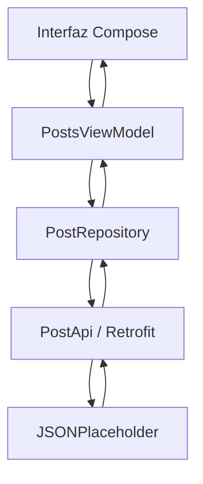
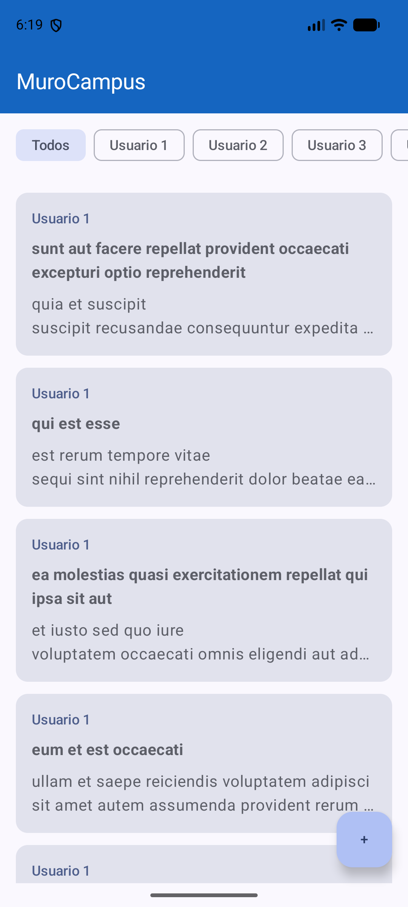
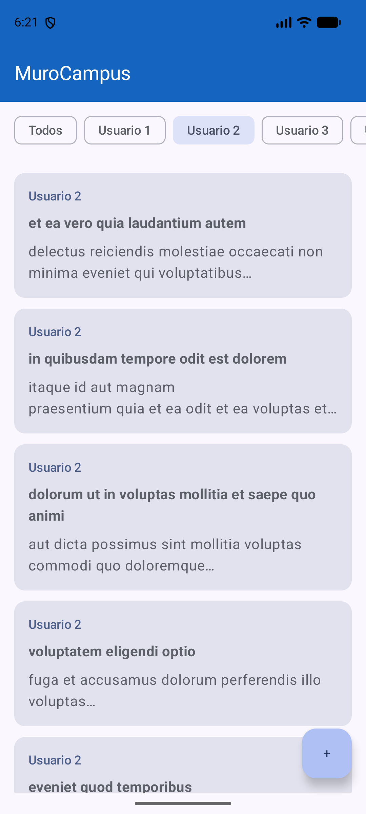
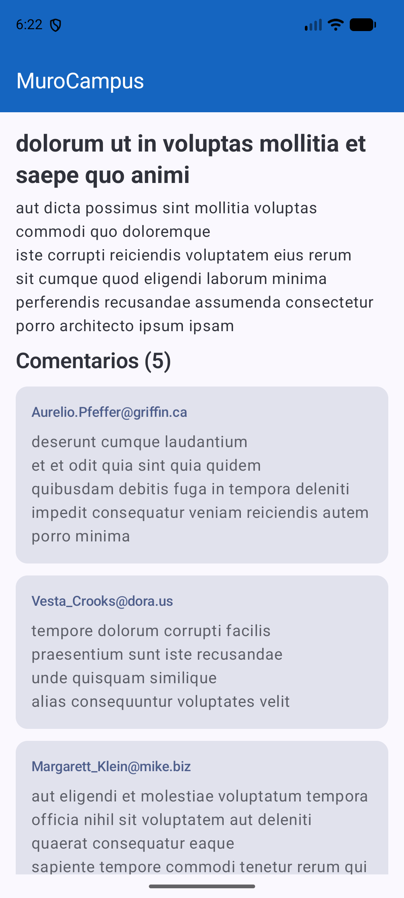
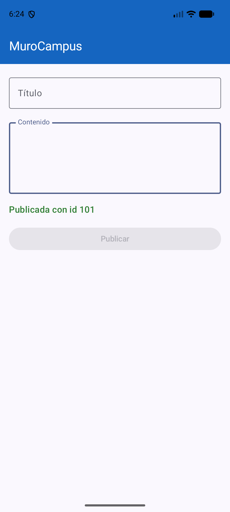
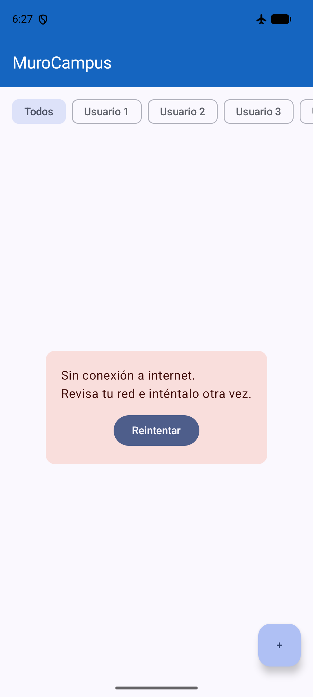

# MuroCampus

Aplicación Android desarrollada en Kotlin y Jetpack Compose para consultar, filtrar, ver el detalle y publicar mensajes. La información se consume desde JSONPlaceholder mediante Retrofit.

## Estructura del proyecto

```text
app/src/main/java/com/quispe/murocampus/
├── MainActivity.kt
├── data/
│   ├── PostRepository.kt
│   ├── remote/
│   │   ├── PostApi.kt
│   │   └── RetrofitClient.kt
│   └── translation/
│       ├── TraductorContenido.kt
│       └── TraductorMlKit.kt
├── model/
│   └── Modelos.kt
├── ui/
│   ├── PantallaCrear.kt
│   ├── PantallaDetalle.kt
│   ├── PantallaLista.kt
│   └── theme/
│       ├── Color.kt
│       ├── Theme.kt
│       └── Type.kt
└── viewmodel/
    └── PostsViewModel.kt
```

## Arquitectura MVVM



La interfaz observa estados expuestos por el ViewModel. El repositorio encapsula las operaciones remotas y Retrofit realiza las solicitudes HTTP.

## Fase 2: traducción al español

En la rama `mejora-ia`, el repositorio traduce al español los títulos y cuerpos de publicaciones y comentarios recibidos en inglés. La traducción se ejecuta en el dispositivo con ML Kit; el modelo inglés-español se descarga por Wi-Fi la primera vez y las traducciones se guardan en memoria mientras la app está abierta. Las publicaciones creadas por la persona usuaria se conservan tal como fueron escritas.

La lista también permite buscar por título en español sin volver a consultar la API. La búsqueda se combina con el filtro por usuario seleccionado.

Todas las solicitudes HTTP incluyen el encabezado `Accept: application/json`, agregado por un interceptor de OkHttp.

La interfaz utiliza una paleta azul fija y tarjetas compactas para acercarse a la referencia visual de la guía, manteniendo los controles de traducción, búsqueda y filtro de la fase 2.

## Capturas

### Lista de publicaciones



### Filtro por usuario



### Detalle y comentarios



### Crear publicación



### Error sin conexión



## Verificaciones realizadas

- Carga de publicaciones y estados de carga/error.
- Filtro por usuario y retorno a todos los usuarios.
- Apertura del detalle y carga de comentarios.
- Envío de publicación con `POST` y `@Body`; JSONPlaceholder responde con el identificador de prueba 101.
- Validación de campos obligatorios antes de habilitar el botón de publicar.
- Mensaje y reintento tras perder la conexión.
- Error HTTP para publicación inexistente y manejo de una respuesta que no coincide con el modelo.
- Revisión de cancelación de solicitudes al cambiar de pantalla.

## Para pensar

1. **¿Qué diferencia hay entre GET y POST?** GET consulta recursos y POST envía datos para crear un recurso. En este proyecto `@Body` serializa el objeto de publicación como JSON y `@Query` agrega el identificador de usuario a la URL.
2. **¿Para qué sirve la ruta relativa del servicio?** `posts` se combina con la URL base configurada en Retrofit. Una ruta que empieza con `/` se resuelve desde la raíz del servidor.
3. **¿Por qué devolver `Result` desde el repositorio?** Permite representar el éxito o el error como un resultado y mantener el tratamiento de fallos fuera de la interfaz.
4. **¿Qué pasa sin permiso de Internet o con JSON distinto?** Sin `INTERNET` no se pueden realizar solicitudes. `ignoreUnknownKeys` tolera propiedades adicionales; los campos obligatorios ausentes o incompatibles pueden causar un error de serialización.
5. **¿Por qué usar un estado sellado?** `UiState` representa de forma explícita carga, éxito y error, evitando combinaciones contradictorias de varios booleanos.
6. **¿Qué cambiaría con un backend real?** El servidor validaría y persistiría la publicación, aplicaría autenticación y devolvería el identificador real. La aplicación debería contemplar esos estados y actualizar la lista con la información confirmada por el servidor.

