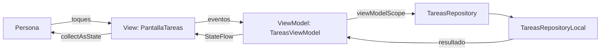

# CentroTareas

Laboratorio de la Semana 14 de Programación en Móviles: uso de corrutinas en Android para ejecutar tareas largas sin bloquear la interfaz.

## Descripción

CentroTareas muestra una tarea con progreso cancelable, un conteo de números primos y dos cargas ficticias de datos. La interfaz usa Kotlin, Jetpack Compose y Material 3; la lógica se organiza con MVVM y Repository. Las cargas usan un perfil ficticio y tres pedidos simulados, sin conexión a servicios reales.

## Estructura del proyecto

```text
com.quispe.centrotareas/
├── MainActivity.kt
├── data/
│   ├── TareasRepository.kt
│   └── TareasRepositoryLocal.kt
├── model/
│   └── Estados.kt
├── ui/
│   ├── PantallaTareas.kt
│   └── theme/
├── viewmodel/
│   ├── TareasViewModel.kt
│   └── TareasViewModelFactory.kt
```

## Arquitectura MVVM + Repository



La pantalla presenta el estado y envía eventos. El ViewModel administra los estados y las corrutinas, y depende de la interfaz `TareasRepository`. `TareasRepositoryLocal` simula las cargas y realiza el cálculo de primos fuera del hilo principal.

## Observación del Paso 1

En el Paso 1, al pulsar **Tarea larga (MAL)**, la pantalla deja de responder durante cuatro segundos: no se pueden tocar los botones ni actualizar el contador. El texto **Trabajando...** no llega a verse mientras dura la espera porque `Thread.sleep(4000)` bloquea el hilo principal, que también debe procesar los toques y dibujar la interfaz. Cuando termina la espera, el hilo principal vuelve a trabajar y Compose muestra **Terminó**.

Si la espera durara diez segundos, Android probablemente detectaría que la aplicación no responde y podría mostrar el diálogo ANR. El tiempo exacto depende del dispositivo y de la operación que esté bloqueando el hilo.

## Comprobaciones de aceptación

| Comprobación | Resultado observado |
| --- | --- |
| Tocar el contador mientras corre la tarea y cancelarla a mitad | El contador llegó a 2; al cancelar, la barra quedó en 62 % y el estado mostró **Cancelado**. |
| Contar primos hasta 1000 | Resultado: 168. |
| Comparar las cargas | En este emulador, **A la vez** tardó 3022 ms y **Una por una** 6639 ms. |
| Compilar la app | `gradlew.bat :app:assembleDebug` terminó correctamente. |
| Revisar `GlobalScope`, `runBlocking` y `Thread.sleep` en el código Kotlin final | No aparecen en `app/src/main/java`. La mención de `Thread.sleep` en este README describe el experimento del Paso 1. |
| Completar la tarea de progreso de 0 a 100 % y observar Logcat | Pendiente de comprobar en un emulador estable. |
| Cancelar un conteo grande de primos | Pendiente de comprobar en un emulador estable. |
| Activar el error, reintentar y luego obtener éxito al desactivarlo | Pendiente de comprobar en un emulador estable. |
| Rotar la pantalla mientras corre una tarea | Pendiente de comprobar en un emulador estable. |

## Para pensar

### 1. ¿Por qué no se veía «Trabajando...» en el Paso 1?

El ViewModel actualizaba el mensaje y enseguida bloqueaba el hilo principal con `Thread.sleep`. Compose necesita ese mismo hilo para dibujar el nuevo estado, por lo que el mensaje no aparecía hasta terminar la espera.

### 2. ¿Qué diferencia hay entre `Thread.sleep` y `delay`?

`Thread.sleep` detiene el hilo que lo ejecuta. `delay` suspende la corrutina sin bloquear el hilo, que queda libre para atender la interfaz u otro trabajo.

### 3. ¿Por qué `Dispatchers.Default` para los primos y `Dispatchers.IO` para la red?

Contar primos consume CPU, por eso corresponde `Dispatchers.Default`. `Dispatchers.IO` se usa para operaciones bloqueantes de entrada y salida. Las cargas de este laboratorio son simuladas con `delay`, que suspende sin bloquear un hilo.

### 4. ¿Qué pasa con la corrutina si el usuario cierra la pantalla? ¿Qué papel cumple `viewModelScope`?

La corrutina sigue ligada al ViewModel aunque la actividad se recree por un cambio de configuración, como una rotación. Cuando el ViewModel deja de ser necesario y se elimina, `viewModelScope` cancela sus corrutinas. La actividad también puede perder el estado si el sistema termina el proceso.

### 5. ¿Por qué `async` tarda unos 3 s y no 5 s? ¿Qué pasa si falla una carga?

`async` inicia las cargas al mismo tiempo, así que el total se aproxima a la más lenta: 3 s. En serie se suman los 2 s y 3 s. Al estar dentro de `coroutineScope`, si una falla, la otra se cancela; el ViewModel relanza `CancellationException` y presenta los demás errores como estado de error para permitir reintentar.
