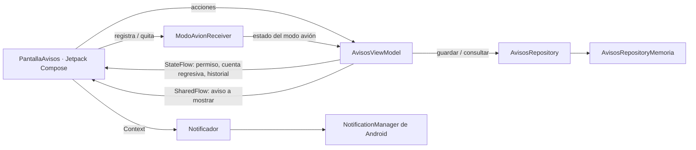
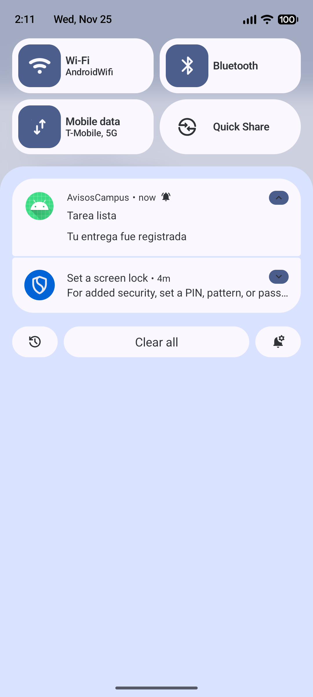
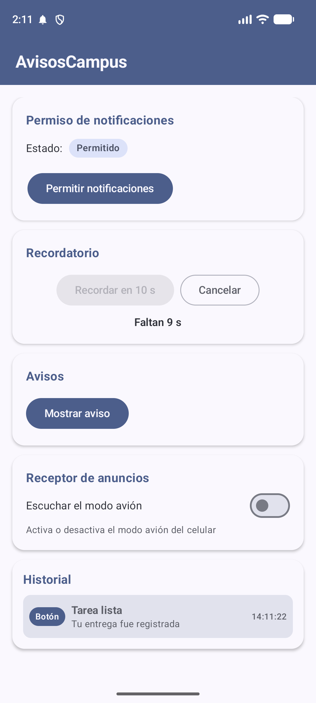
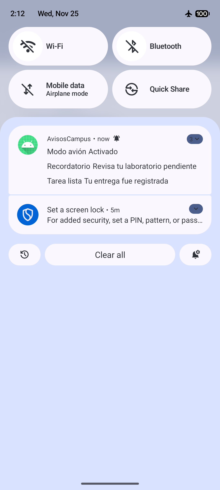
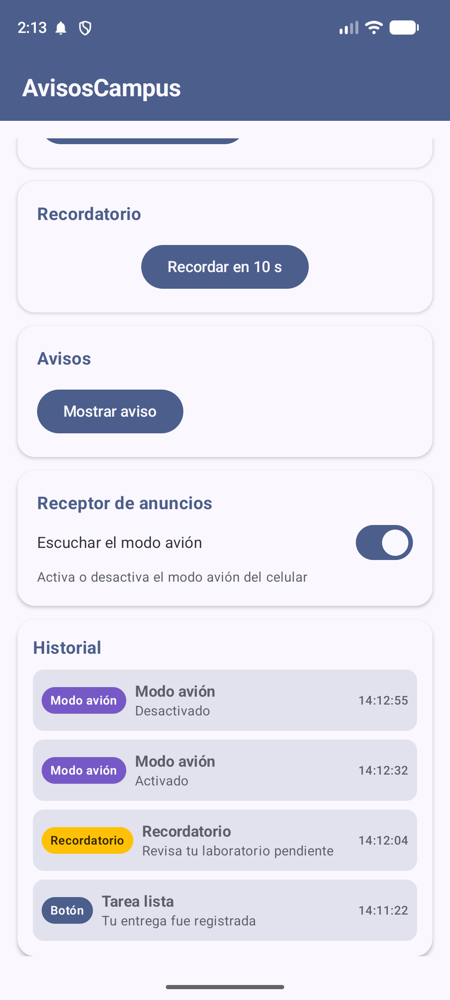
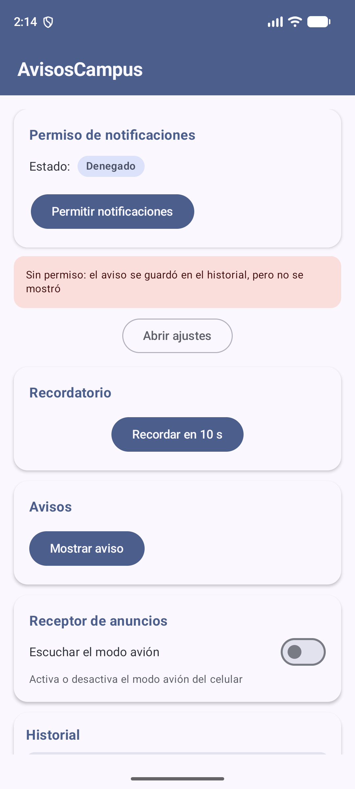

# AvisosCampus

Aplicación Android de avisos locales hecha con Kotlin, Jetpack Compose y Material 3. Permite pedir el permiso de notificaciones, mostrar un aviso inmediato, programar un recordatorio de 10 segundos, escuchar los cambios del modo avión y consultar un historial en memoria.

**Paquete:** `com.quispe.avisoscampus`

## Funciones

- Crea el canal de notificaciones **Avisos** al iniciar la aplicación.
- Solicita `POST_NOTIFICATIONS` en Android 13 o superior y muestra su estado.
- Muestra notificaciones locales y abre la aplicación cuando se tocan.
- Programa un recordatorio con cuenta regresiva y opción para cancelarlo.
- Escucha los cambios del modo avión mientras el switch está activo.
- Registra los avisos en un historial en memoria con los más recientes primero.
- Explica qué ocurre cuando se deniega el permiso y ofrece abrir los ajustes.

## Estructura de paquetes

```text
com.quispe.avisoscampus/
├── AvisosApp.kt
├── MainActivity.kt
├── data/
│   └── AvisosRepository.kt
├── model/
│   └── Aviso.kt
├── notificacion/
│   └── Notificador.kt
├── receiver/
│   └── ModoAvionReceiver.kt
├── ui/
│   ├── HistorialAvisos.kt
│   ├── PantallaAvisos.kt
│   └── theme/
│       ├── Color.kt
│       ├── Theme.kt
│       └── Type.kt
└── viewmodel/
    └── AvisosViewModel.kt
```

## Arquitectura MVVM + Repository



El ViewModel decide qué aviso registrar y emite un evento. La pantalla recibe el evento y llama a `Notificador`, que usa el `Context` para interactuar con Android. El receptor del modo avión solo comunica el estado recibido; la pantalla lo registra mientras el switch permanece activo y lo elimina al salir.

## Capturas

Capturas de la app ejecutada en el emulador Android. El panel y el diálogo de permisos pertenecen al sistema operativo.

### Notificación en el panel



### Cuenta regresiva del recordatorio



### Aviso del modo avión



### Historial de avisos



### Permiso denegado



## Para pensar

1. **¿Por qué una notificación necesita un canal y un permiso? ¿Qué pasa si falta cada uno?**

   Desde Android 8, cada notificación debe pertenecer a un canal para que la persona pueda controlar su importancia y comportamiento en los ajustes del sistema. Si no existe el canal, Android no muestra la notificación. Desde Android 13, la app también necesita el permiso `POST_NOTIFICATIONS`; si se deniega, la app puede seguir funcionando y guardar el aviso en el historial, pero el sistema no lo presenta.

2. **¿Por qué el ViewModel emite un evento y no muestra la notificación él mismo?**

   El ViewModel no debe conocer `Context` ni servicios de Android. Registra los datos y emite el evento; la pantalla, que sí tiene acceso al contexto, invoca el notificador. Así se mantienen separadas las decisiones de la aplicación y la interacción con el sistema.

3. **¿Qué pasa si usas el mismo id en dos notificaciones?**

   Android reemplaza la notificación anterior que tenga el mismo identificador dentro de la app. Con ids distintos, las notificaciones aparecen como avisos separados.

4. **¿Por qué `onReceive` debe ser corto y por qué hay que quitar el receptor al salir?**

   `onReceive` se ejecuta en el hilo principal y debe terminar rápidamente para evitar bloquear la interfaz o provocar un ANR. Un receptor dinámico debe desregistrarse al salir para evitar fugas de memoria, referencias a pantallas cerradas y entregas duplicadas.

5. **¿En qué casos usarías una notificación local y en cuáles una push de Firebase?**

   Usaría una notificación local para recordatorios o eventos que el dispositivo puede calcular por sí mismo, como esta cuenta regresiva. Usaría una notificación push de Firebase cuando el evento nace en un servidor y debe llegar al dispositivo, por ejemplo un mensaje o una actualización que ocurre mientras la app no está abierta.

## Compilar

Desde esta carpeta ejecuta:

```bash
./gradlew :app:assembleDebug
```
